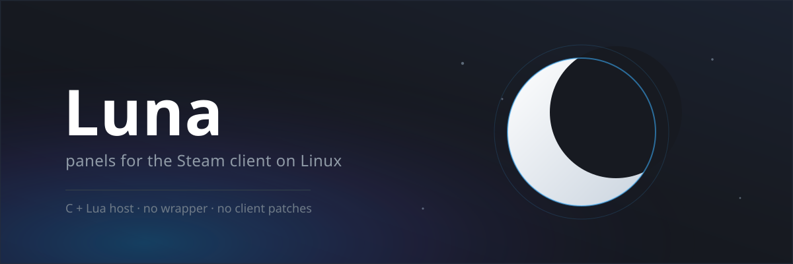
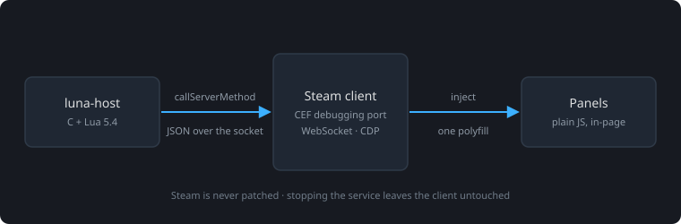

<p align="center"></p>

# Luna

[](LICENSE)
[](#requirements)
[](#what-luna-does-not-do)
[](#how-it-works)

Luna adds a small set of panels to the Steam client on Linux (Arch, Steam Deck
and any distro with a normal Steam install): playtime you can edit, a presence
view, an artwork picker, a graphics/tooling page and a btrfs dedupe panel. It
runs as one user service on your own machine and talks to Steam over the
client's own CEF debugging port — no wrapper, no patched Steam binary.

<p align="center"></p>

```
~/.local/share/Luna/
  bin/luna-host      the host (Lua 5.4 inside, see host/)
  lua/               its Lua tree + the add-on API
  addons/<name>/     one directory per add-on
  data/              your playtime, presence and settings
```

## Features

| Feature | What it does |
|---|---|
| **Playtime** | Native-library playtime per game, with a manual correction field; reads Steam's own `loginusers.vdf`/`appmanifest_*.acf`/`shortcuts.vdf` |
| **Presence** | Shows and edits what your friends see while you play; reads `gamemode`/`gamescope` state and an optional Discord IPC socket |
| **Artwork (SGDB)** | Search SteamGridDB, apply grids/heroes/logos/icons and restore the originals; needs your own API key |
| **Graphics** | GPU and runtime page: `lsfg-vk` layers, OptiScaler and its client, Steam runtime, cached results |
| **Compressor** | Drives an external `btrfs-game-compressor` binary (bring your own) with a per-game queue and a read-only stats view |
| **Steam client pin** | Pin the working client build, lock updates with `steam.cfg`, roll back after an unwanted update |
| **SteamOS Mode helpers** | Launcher shortcuts for Gaming Mode |
| **Doctor / verify** | Plain-language diagnostics and a manifest check over every shipped file |

## What Luna does not do

- It does not unlock, patch, add or "own" games, and it does not touch DRM or
  ownership in any way. Nothing here makes Steam believe you own something.
- It does not modify Steam's binaries, `package/` or any launcher script. The
  only Steam files it writes are `steam.cfg` (when you ask for the update lock)
  and your own `userdata` files, and only from the panels that edit them.
- It does not move the Steam client to another build unless you ask: `luna
  steam lock` / `luna steam pin --build N` are explicit commands.
- It does not collect telemetry. The only network calls are SteamGridDB with
  your key, HowLongToBeat's public search, and GitHub when you run `luna
  update` or `luna check`.

## Requirements

- Arch, SteamOS or any distro with a native Steam install (`~/.steam/steam`,
  `~/.local/share/Steam` or `~/.steam/debian-installation`).
- `cc` and `make` once, at install time (the host is built from source; the
  Lua 5.4.7 runtime is vendored, MIT).
- A systemd **user** session.
- Steam's CEF debugging port: Luna writes `.cef-enable-remote-debugging` into
  the Steam root if it is missing (port 8080), and restarts nothing by itself.
- Optional: `gamescope`/`gamemode` for presence detail, `zenity` for GUI
  prompts, `btrfs-game-compressor` for the compressor panel, a SteamGridDB key.

**Steam must be closed while installing.** The service is enabled, not started
while Steam runs.

## Install

```sh
curl -fsSL https://raw.githubusercontent.com/pgm1207/luna-toolkit/main/install.sh | bash
```

From a checkout:

```sh
bash install.sh --local .          # real install
bash install.sh --local . --dry-run
```

The installer downloads the release bundle (`luna.tar.gz` + `.sha256`),
verifies it, builds `host/`, copies the binary, Lua tree and add-ons into
`~/.local/share/Luna`, writes and enables `luna-host.service` (user unit),
symlinks `~/.local/bin/luna`, and prints the uninstall line.

Uninstall:

```sh
curl -fsSL https://raw.githubusercontent.com/pgm1207/luna-toolkit/main/uninstall.sh | bash
# or, locally:
bash uninstall.sh            # keeps ~/.local/share/Luna/data
bash uninstall.sh --purge    # removes everything
```

## CLI

```
luna install [--only NAME] [--dry-run] [--force] [--lock-steam-client]
luna uninstall [--only NAME]
luna status [--strict]
luna verify
luna doctor
luna launchers [--dry-run] [--migrate-legacy]
luna steam status|pin|unpin|cache|recover|update|cancel|lock|unlock|heal|history
luna release [--out DIR] [--publish]
luna update --bundle FILE | --url URL | --latest [--dry-run]
luna backup [--out DIR]
luna restore ARCHIVE [--force]
luna timer on|off|status
luna check [--force]
```

`luna steam` owns the client build: `pin` records the running build and blocks
updates, `lock` rolls back to the pinned ubuntu12 build and makes `package/`
read-only, `unlock` undoes both, `recover` re-installs the pinned files,
`history` lists SteamTracking's builds. Exit codes are documented in
`luna --help`.

## Status

Luna is a personal project, published because it is useful. It targets the
Steam client as it is today on Linux; a Steam update can move the UI or the
debugging endpoint, and the pin plus `luna steam recover` exist for exactly
that. Issues and pull requests are welcome, but there is no support promise.

## Troubleshooting

**The panels do not appear.** Check `luna doctor` and `systemctl --user status
luna-host`. The host attaches to Steam's CEF debugging port: make sure
`~/.steam/steam/.cef-enable-remote-debugging` exists and that Steam was
restarted after Luna was installed. The port can collide with another app; Luna
reads the port from the client, and `luna doctor` prints what it found.

**Nothing loads after a Steam update.** Steam updates can rename the client's
UI components or move the debugging endpoint. Run `luna doctor`, then `luna
update --latest` for a build that matches the new client. The Steam pin exists
precisely to make "put the old client back" a two-command operation
(`luna steam recover`, `luna steam pin`).

**A panel says the host is missing.** The add-ons only ever talk to the host;
`luna install --force` rewrites the tree and the unit, and `luna status` says
which file drifted.

**Steam will not update any more.** That is `steam.cfg` doing its job:
`luna steam unlock` removes the lock and the pin.

## How it works

Steam ships a Chromium-based UI and can expose a Chrome DevTools Protocol
endpoint (`--remote-debugging-port`, enabled by the `.cef-enable-remote-debugging`
file in the Steam root). `luna-host` (C + vendored Lua 5.4.7) connects to that
endpoint over a WebSocket it speaks itself, finds the client's JS context and
injects one small polyfill. The polyfill exposes a single call:
`window.Millennium.callServerMethod(plugin, fn, args)`, which is marshalled back
to the host, dispatched to the add-on's Lua `register(registry)` table, and
answered as JSON. Add-ons therefore run as ordinary Lua files with no network
listener of their own, and the UI side is plain JS injected into a page that
Steam already renders. The client is never patched, and killing `luna-host`
leaves Steam untouched.

## Development

```sh
make -C host all          # build the host
make -C host test         # rt_* and cdp_* suites against the real binary
bash scripts/test-all.sh  # everything: node, Lua, host, Python, verify
python3 scripts/luna.py status
```

Add-on sources live in `addons/<name>/plugin/`; `scripts/make-manifest.py`
re-pins `vendor/MANIFEST.json` after a change, and `luna verify` checks it.

## License

MIT, see `LICENSE`. Lua 5.4.7 is MIT, see `THIRD_PARTY_NOTICES.md` and
`host/vendor/lua-5.4.7/src/lua.h`.
